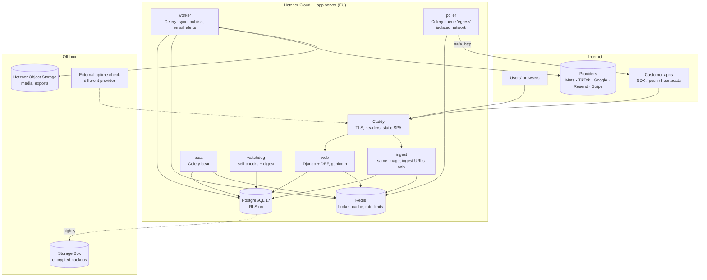
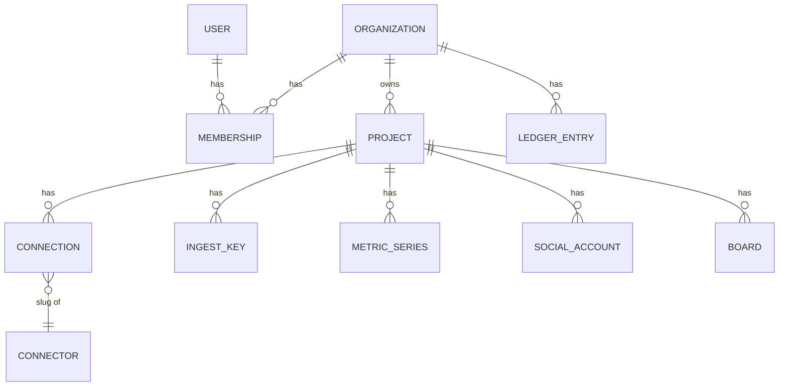
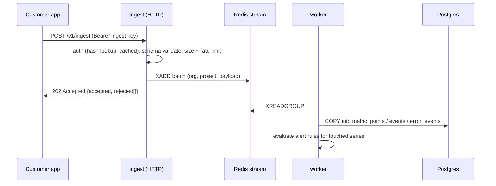

# Architecture overview

- **Status:** Draft v1 · 16 Oct 2026
- Decisions referenced as ADRs live in [decisions/](decisions/).

## Shape

A modular Django monolith with a React SPA, Celery workers, Postgres and Redis,
deployed with Docker Compose on Hetzner. One codebase, several process types.
Boring on purpose: one person must be able to run it, and every piece is
something the maintainer already operates.



### Process types (one image, different commands)

| Service | Command | Why separate |
|---|---|---|
| `web` | gunicorn (app API, auth, admin) | User-facing latency |
| `ingest` | gunicorn with `ROOT_URLCONF=config.urls_ingest` | Ingestion floods must not slow the app; own rate limits and worker count |
| `worker` | `celery -Q default,sync,publish,email` | Provider calls, scheduled publishing |
| `poller` | `celery -Q egress` | Fetches customer URLs (status endpoints, uptime probes); on the `broker` + `egress` networks only, with **no route** to Postgres (see [security.md § SSRF](../practices/security.md#outbound-http-and-ssrf)). Its tasks take a URL and pre-signed headers and hand results back to a default-queue task |
| `drainer` | `manage.py drain_ingest` | Reads the ingest Redis stream (consumer group) and writes batches to Postgres; independent of Celery so a busy worker never delays ingestion |
| `beat` | `celery beat` (django-celery-beat) | Schedules |
| `watchdog` | management command loop | Self-monitoring and the daily digest, independent of Celery so its silence is meaningful |
| `caddy` | Caddy | TLS, security headers, serves the built SPA |

## Backend modules (Django apps)

| App | Owns |
|---|---|
| `accounts` | Users, auth (allauth headless), MFA, sessions |
| `tenancy` | Organization, Membership, Role, Project, Invitation; tenant middleware; RLS helpers |
| `integrations` | Connector registry, Connection, credential vault, sync engine, catalogue API |
| `connectors.*` | One package per provider implementing the `Connector` interface |
| `ingest` | Public ingestion API, heartbeats, status-endpoint poll scheduling, key management |
| `monitoring` | Checks, metric series, alert rules, incidents, notifications, digest |
| `social` | Accounts, posts, variants, media, schedule, publish attempts, post metrics |
| `email` | Audiences, contacts, campaigns, schedule, delivery stats |
| `analytics` | GA4 and ads read models |
| `finance` | Ledger entries, categories, recurring rules, imports, FX rates, unit economics |
| `boards` | Boards, columns, cards, links (generic relation to alerts, posts, campaigns, entries) |
| `audit` | Append-only audit events |
| `core` | `http` / `safe_http`, money, time, ids (UUIDv7), feature flags |

Apps talk through **service functions** (`services.py`), not by reaching into each
other's models. Cross-app links use explicit FKs or the `boards` generic link.

## Tenancy model



- **Organization** = the tenant and the billing unit. **Project** = one product
  (Pantrini). Most data hangs off a project; finance hangs off the organization
  (with optional project allocation).
- Every tenant table carries `organization_id` (even when derivable through
  project) so RLS policies are one simple predicate. See
  [ADR 0002](decisions/0002-shared-schema-tenancy-with-rls.md).

## Connector framework

```python
class Connector(Protocol):
    meta: ConnectorMeta                                    # catalogue metadata

    def begin_auth(self, ctx: AuthContext) -> AuthStart: ...       # OAuth URL or form
    def complete_auth(self, ctx: AuthContext, payload: dict) -> Credentials: ...
    def validate(self, conn: Connection) -> ValidationResult: ...  # wizard step checks
    def discover(self, conn: Connection) -> list[Resource]: ...    # pages, IG accounts, properties
    def sync(self, conn: Connection, kind: SyncKind, window: Window) -> SyncResult: ...
    def publish(self, conn: Connection, item: Publishable) -> PublishResult: ...   # if capable
    def handle_webhook(self, request: HttpRequest) -> WebhookResult: ...          # if capable
    def revoke(self, conn: Connection) -> None: ...
```

- `Connection` row: `organization`, `project`, `connector_slug`, `mode`
  (`platform` | `byo_app` | `key`), `status` (`pending`, `connected`,
  `needs_reauth`, `error`, `disabled`), `credentials_encrypted`, `app_credentials_encrypted`
  (BYO), `scopes`, `last_synced_at`, `last_error`.
- The sync engine schedules each connection's sync kinds from metadata
  (e.g. Instagram media insights hourly, followers daily), with per-provider
  concurrency limits and jittered start times so syncs do not stampede on the hour.
- **BYO app** and **platform** modes share all code except where the client id /
  secret come from. See [ADR 0004](decisions/0004-byo-app-credentials.md).

## Ingestion pipeline

Detailed in [ingestion-contract.md](ingestion-contract.md).



Accept fast, validate strictly, write in batches. Redis Streams give back-pressure
and replay; if Redis is down, `ingest` returns `503 Retry-After` and SDKs buffer.

As built (Phase 1): the `ingest` view resolves the key through
`ingest_credentiallookup` (hash → organization, [ADR 0008](decisions/0008-credential-lookup-and-dbless-poller.md)),
then works under that tenant's RLS. The `drainer` (`manage.py drain_ingest`, not
Celery) reads with `XREADGROUP`, writes through `monitoring.write`
(multi-row `INSERT … ON CONFLICT DO NOTHING RETURNING` rather than `COPY`, so
replays are no-ops and rollups are updated only for new points), and `XACK`s
after commit. Entries a crashed drainer left pending are reclaimed with
`XAUTOCLAIM` after 60 s; an entry that fails five times is moved to
`cmdr:ingest:dead`.

Pull side: `beat` enqueues due polls on the `egress` queue; `poller` fetches with
`safe_http` and signed requests, then hands the document to the same write path.
Due polls are claimed with `SELECT … FOR UPDATE SKIP LOCKED` per tenant and
their `next_run_at` moved (with jitter) before enqueueing, so two schedulers
never send the same poll. The heartbeat endpoints write directly (low volume,
rate-limited per heartbeat).

## Metric storage

Plain PostgreSQL first ([ADR 0006](decisions/0006-metrics-in-postgres.md)):

- `metric_series(id, organization_id, project_id, name, kind, unit, attrs_hash, attrs jsonb)`
- `metric_points(series_id, organization_id, ts, value double precision)` —
  **declaratively partitioned by month**, BRIN index on `ts`, btree on
  `(series_id, ts)`.
- `metric_rollups_1m`, `metric_rollups_1h` (min/max/avg/sum/count/last) maintained
  by the worker; dashboards read rollups, alerts read recent raw points.
- Retention drops whole partitions — instant and vacuum-free.
- Cardinality guard: max series per project and max distinct attribute values per
  key, per plan; excess is rejected with a clear error, never silently dropped.

Revisit (TimescaleDB or ClickHouse) only when a measured limit is hit.

## Publishing and scheduling

- `ScheduledItem` (post variant or email campaign) with `run_at`, `state`
  (`draft` → `approved` → `scheduled` → `publishing` → `published` | `failed`),
  `attempts`, `last_error`.
- `beat` runs a minutely dispatcher that claims due items with
  `SELECT … FOR UPDATE SKIP LOCKED` and enqueues `publish` tasks — robust to
  restarts and to running two dispatchers.
- Publishing is idempotent per item (provider-side idempotency keys where
  available; otherwise we record the provider id before marking success and check
  for it on retry).
- Resend broadcasts use Resend's own `scheduled_at` where possible, so a Commandr
  outage does not delay an email.

## Alerting and the digest

- Checks produce `ok | warn | fail | unknown` with a key; alert rules turn series
  into checks (threshold, absence, rate of change).
- Notification state machine per key: first failure → alert; repeated failure →
  cooldown (1h); recovery → "passing again" message. Keys that disappear count as
  recovered (pattern proven in Pantrini's `apps/ops`). `warn` goes to the digest
  only; `unknown` holds the state and never counts as a recovery. Checks whose
  source stops reporting turn `unknown` after three intervals. Notifications are
  an outbox (`monitoring_notification`, unique `dedupe_key`) sent after commit
  by an idempotent task, by email (Django SMTP → Resend) to owners and admins.
- Daily digest per project at the org's chosen hour: verdict line, failing checks,
  24h resource summary, KPIs, scheduled posts/emails for the day, board cards due.
  Phase 1 sends it from `MONITORING_DIGEST_HOUR` (default 07:00) in the
  organization's time zone, once per local day, with three verdicts: healthy,
  needs attention, nothing was checked. It runs from Celery beat for now;
  moving it into `watchdog` is a follow-up.
- Commandr runs the same machinery on itself (`watchdog`), plus an external uptime
  check from a different provider.

## Frontend

- React 19 + TypeScript + Vite; React Router; TanStack Query; React Hook Form +
  Zod; Tailwind (tokens) + Radix primitives; Recharts or visx for charts; dnd-kit
  for boards; i18next.
- Types generated from the OpenAPI schema (`drf-spectacular` → `openapi-typescript`)
  so the client cannot drift from the API.
- Feature folders mirror product areas; the catalogue and wizard are driven by
  `GET /api/catalogue` (registry metadata + connection states).

## Environments and deployment

| Env | Where | Data |
|---|---|---|
| local | Docker Compose on the dev machine | Seeded fake orgs |
| staging | Small Hetzner server (or same server, separate stack, during the solo phase) | Fake data + Pantrini staging |
| production | Dedicated Hetzner server (CX32-class to start), separate from Pantrini's | Real |

Images from CI (GHCR), deployed via Portainer; migrations run as a one-off before
app containers update; expand/contract migrations only. Details in
[git-process.md § Releases](../practices/git-process.md#releases-and-deploys).

## Scaling path (only when measured)

1. Bigger server; separate Postgres onto its own server with a private network.
2. More `worker` / `ingest` replicas (stateless).
3. Postgres read replica for dashboards.
4. Metrics to TimescaleDB or ClickHouse if partitioned Postgres hits limits.
5. Kubernetes only if multiple servers become operationally painful — not before.
