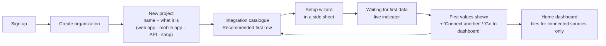

# Onboarding and the integration catalogue

The product's front door. A new user does not land on an empty dashboard; they
land on **everything that can feed Commandr**, pick one, and see their own data
within minutes. The dashboard then assembles itself from what is connected.

## The flow



1. **Sign up** — email or Google; MFA offered immediately, required before an
   owner connects a social account.
2. **Organization** — name, country (sets currency and time zone defaults).
3. **Project** — name, URL, and kind (`web app`, `mobile app`, `API`, `shop`). The
   kind chooses the "Recommended first" row.
4. **Catalogue** — the project's home until at least one source is connected.
5. **Wizard → first data** — every wizard ends showing real values, or a precise
   "waiting for…" with what happens next and a link to troubleshooting.
6. **Dashboard** — only tiles for connected sources, plus one "Add more data"
   tile pointing back at the catalogue. Catalogue stays one click away in the
   navigation ("Integrations").

**Time-to-first-data targets:** uptime probe 30 s · heartbeat 1 min · Resend 2 min ·
SDK 5 min · GA4 3 min · Meta/TikTok (BYO app) 15 min the first time, then 1 min
per account.

## The catalogue screen

```
┌────────────────────────────────────────────────────────────────────────────┐
│ Pantrini › Integrations                                [Search integrations]│
│ Connect what you already use. Each one unlocks part of Commandr.            │
│                                                                              │
│ Recommended first                                 2 of 4 recommended connected│
│ ┌──────────────┐ ┌──────────────┐ ┌──────────────┐ ┌──────────────┐          │
│ │ ⏱ Uptime     │ │ 🐍 Django SDK │ │ ✉ Resend     │ │ 📸 Instagram │          │
│ │ Know when    │ │ Health, errors│ │ Schedule     │ │ Schedule and │          │
│ │ you're down  │ │ and KPIs      │ │ newsletters  │ │ measure posts│          │
│ │ ~30 s · Free │ │ ~5 min · Free │ │ ~2 min       │ │ ~15 min      │          │
│ │ ✓ Connected  │ │ ✓ Connected   │ │ [Connect]    │ │ [Connect]    │          │
│ └──────────────┘ └──────────────┘ └──────────────┘ └──────────────┘          │
│                                                                              │
│ [All] [App health] [Analytics] [Social] [Email] [Ads] [Money] [Work]         │
│ …grid of every connector, same card…                                         │
└────────────────────────────────────────────────────────────────────────────┘
```

Card contents (all from connector metadata): logo · name · one-line *what it
unlocks* · estimated setup time · requirement chips (`Free`, `Needs a Meta app`,
`Business account required`, `Paid API`) · state (`Connect` / `Connected` /
`Needs attention` / `Coming soon`). Selecting a card opens its detail sheet:
what data is read, what Commandr can do with it (read-only vs publish), setup
steps, and the privacy note.

**Recommended first** by project kind:

| Kind | Recommended |
|---|---|
| Web app / API | Uptime probe · SDK (or status endpoint) · GA4 · Resend |
| Mobile app | SDK (backend) · Heartbeat · Instagram · TikTok |
| Shop | Uptime probe · GA4 · Instagram · Meta Ads |

## Connector catalogue (v1)

Auth types: **platform** = Commandr's own OAuth app · **BYO app** = the customer
registers their own developer app and pastes its credentials · **key** = an API key
from the provider · **ingest** = a Commandr-issued key · **none**.

### App health

| Connector | Auth | Unlocks | Provider cost | Phase |
|---|---|---|---|---|
| Uptime probe | none | Up/down, latency, TLS expiry | — | 1 |
| Heartbeat | ingest (URL token) | Missed-job alerts | — | 1 |
| Status endpoint | HMAC secret | Checks, gauges, KPIs pulled every 1–5 min | — | 1 |
| Push API | ingest | Events, metrics, errors | — | 1 |
| Django SDK | ingest + HMAC | All of the above in one `pip install` | — | 1 |
| Node / FastAPI SDK | ingest + HMAC | Same | — | 2–3 |
| OpenTelemetry | ingest | Standard OTLP metrics/logs | — | 3 |

### Social

| Connector | Auth | Unlocks | Provider cost / gate | Phase |
|---|---|---|---|---|
| Facebook Page | BYO app → platform | Publish, page insights | Free; platform mode needs Meta App Review + Business Verification | 1 |
| Instagram (Business/Creator) | BYO app → platform | Publish, media insights | Free; same as above | 1 |
| TikTok | BYO app → platform | Upload to drafts; direct post after audit; video stats | Free; audit for public direct posting | 1 |
| LinkedIn Page, YouTube, Threads, Bluesky | platform | Publish + stats | Free; LinkedIn partner approval is slow | 3 |
| X | BYO app | Publish | Pay per use | 3 |

### Email

| Connector | Auth | Unlocks | Provider cost | Phase |
|---|---|---|---|---|
| Resend | key (restricted) | Audiences, broadcasts, scheduling, delivery stats | Customer's Resend plan (marketing free to 1,000 contacts) | 1 |

### Analytics and ads

| Connector | Auth | Unlocks | Gate | Phase |
|---|---|---|---|---|
| Google Analytics 4 | platform OAuth | Traffic, sources, conversions | Google OAuth verification for production | 2 |
| Google Ads | platform OAuth + our developer token | Spend, conversions, CPA | Developer token Basic access | 2 |
| Meta Ads | BYO app → platform | Spend and results | As Meta above | 2 |

### Money

| Connector | Auth | Unlocks | Phase |
|---|---|---|---|
| Stripe | key (restricted, read-only) | Revenue, fees, MRR, churn | 2 |
| Google Play reports | service account (bucket read) | Installs, subscription revenue | 3 |
| CSV / bank export | upload | Any other income/expense | 2 |
| Manual & recurring entries | built-in | Hosting, domains, tools | 1 |

### Work

| Connector | Auth | Unlocks | Phase |
|---|---|---|---|
| Board (built-in) | — | Kanban with links to everything above | 1 |
| GitHub | platform OAuth (GitHub App) | Link cards to issues/PRs, deploy markers on charts | 3 |

## BYO-app setup (Meta, TikTok) — making it bearable

The one slow setup. The wizard turns it into a checklist:

1. "Create a Meta app" — link to the developer console, with the app type to pick.
2. "Add these products" — Instagram Graph API / Facebook Login for Business,
   with exact permission names to request (e.g. `instagram_basic`,
   `instagram_content_publish`, `pages_manage_posts`, `pages_read_engagement` —
   re-check against Meta's docs when building, names change between API versions).
3. "Paste this redirect URL" — `CopyField` with our callback for their app.
4. "Add yourself as a tester / keep the app in development mode" — with the why.
5. "Paste your App ID and App Secret" — stored in the vault.
6. "Connect your accounts" — OAuth through **their** app; pick Pages / IG accounts.
7. First data: the last 10 posts and their stats.

A docs page per BYO connector mirrors these steps with screenshots, and the wizard
validates each step (e.g. calls `debug_token` to confirm granted permissions)
before letting the user continue.

When Commandr's own platform app is approved, the same card offers **"Connect with
Commandr's app"** as the default and keeps BYO as an advanced option (still the
only option on self-hosted).

## Connector metadata (what the catalogue renders)

```python
class Connector:
    slug = "resend"                       # stable forever; stored on rows
    name = "Resend"
    category = Category.EMAIL
    auth = AuthType.API_KEY
    capabilities = {Cap.READ_CONTENT, Cap.SCHEDULE, Cap.READ_METRICS, Cap.WEBHOOK}
    unlocks = "Schedule newsletters and see who opened them."
    setup_minutes = 2
    requirements = [Req.FREE_TIER_AVAILABLE]
    recommended_for = {ProjectKind.WEB_APP}
    docs_path = "connectors/resend"
    phase = 1
    steps = [...]                         # wizard steps, each with a validator
```

See [architecture/overview.md § Connector framework](../architecture/overview.md#connector-framework).
